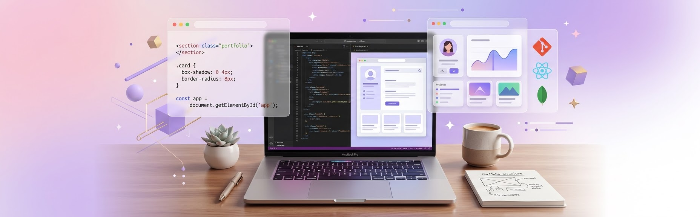

# ¡ Hola, soy Paula ! 👋

  

<h3 align="center">Desarrolladora web junior · ASIR + DAW</h3>

  Desarrollo web · Tecnología · Creatividad

---

### Sobre mí

Soy titulada en Administración de Sistemas Informáticos en Red (ASIR) y Desarrollo de Aplicaciones Web (DAW).

Mi formación y experiencia me han permitido trabajar con diferentes tecnologías, desarrollar aplicaciones y conocer distintos ámbitos del entorno informático.

Me gusta aprender creando, explorar nuevas herramientas y convertir ideas en proyectos reales.

### Tecnologías

**Lenguajes y desarrollo**

HTML · CSS · JavaScript · PHP · Java · Python

**Bases de datos**

MySQL · MongoDB

**Herramientas y tecnologías**

GitHub · Docker · AWS · Power BI · Grafana · Prometheus · Zabbix

### Mis proyectos

🐾 **Zireba** — Aplicación web para la organización y el cuidado de mascotas.

📚 **Lumo** — Aplicación web orientada a la organización académica y la gestión del estudio.

### Contacto

💼 LinkedIn: [Mi perfil](https://www.linkedin.com/in/paula-aceituno-sanchez/)

💻 GitHub: [Mis repositorios](https://github.com/paula-aceituno)

---

  <i>Aprender, crear y seguir desarrollando.</i> ✨

